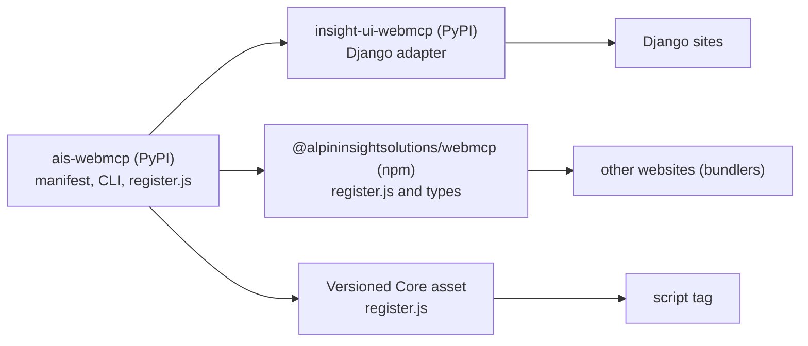

# Insight UI WebMCP — make your website agent-ready

Bring WebMCP to your Django website with an extension designed for Insight UI.
Expose public content, navigation and reviewed actions as explicit tools, while
your application keeps control of content, permissions and execution.

**DE:** Die WebMCP-Erweiterung für Insight UI: Machen Sie die Inhalte und Aktionen
Ihrer Django-Webseite für KI-Agenten verständlich und gezielt nutzbar.

## Packages at a glance

One browser runtime, register.js from the ais-webmcp core, delivered three ways;
this package is the Django adapter and uses the installed core instead of
shipping its own copy.



Documentation: <https://insight-ui-webmcp.alpininsight.ai/>

Status: early preview. `insight-ui-webmcp` has been published on PyPI since
20.10.2026 (0.1.x); interfaces may still change. WebMCP is a draft of the
[W3C Web Machine Learning Community Group](https://www.w3.org/community/webmachinelearning/)
([draft specification](https://webmachinelearning.github.io/webmcp/)), not a
W3C Standard. This package targets the `document.modelContext` API only.

The [ais-webmcp core](https://pypi.org/project/ais-webmcp/) owns register.js.
For websites without Django, the Core browser runtime has been published on npm
as [`@alpininsightsolutions/webmcp`](https://www.npmjs.com/package/@alpininsightsolutions/webmcp)
since version 0.2.0 (13.11.2026). This adapter does not need the npm package; it
uses the Core installed from PyPI and supports the Core 0.1.x and 0.2.x series.
The unscoped npm package `webmcp` is unrelated.

```bash
uv add insight-ui-webmcp
uv run python manage.py webmcp_prepare --profile webpage --dry-run
uv run python manage.py webmcp_prepare --profile webpage
uv run python manage.py webmcp_validate webmcp.manifest.json
```

Add `insight_ui_webmcp` to `INSTALLED_APPS`, then load `` from
`webmcp_tags` once in your site shell. The tag emits the helper only. It adds
`<meta http-equiv="origin-trial">` only when `WEBMCP_ORIGIN_TRIAL_TOKEN` is set,
and status never prints that value. In the page, `InsightUiWebmcp.status()`
reports `ok`, `no-origin-trial-meta` or `no-model-context`. Commit the host manifest; `webmcp_prepare`
keeps an existing file unless `--force` is passed. `subscribe_newsletter` is
written `enabled: false` and this package does not register a submit handler.
Explicit host profiles bind the shared manifest to your own content and handlers.
Read-only `webpage` tools declare an `outputSchema` (a JSON Schema object beside
`inputSchema`), part of the WebMCP draft specification since
[webmachinelearning/webmcp#254](https://github.com/webmachinelearning/webmcp/pull/254). See [Output schemas](#output-schemas).
Local staticfiles are the default; CDN use requires an immutable matching version
and your host's CSP approval.

## Settings

| Setting | Default | Effect |
|---|---|---|
| `WEBMCP_ENABLED` | `False` (host switch) | Hosts set it; `` renders only when it is `True` |
| `WEBMCP_ATTRIBUTION` | `True` | Visible attribution notice; `False` turns it off |
| `WEBMCP_ORIGIN_TRIAL_TOKEN` | unset | Emits the origin-trial meta tag; never printed by status |
| `WEBMCP_ASSET_MODE` | `"local"` | `"cdn"` requires `WEBMCP_CDN_VERSION` matching the installed `ais-webmcp` core |
| `WEBMCP_PROFILES` | `()` | Dotted host profile classes |

`` renders a small `<small>` element,
`Insight UI WebMCP · Apache-2.0 · © Alpin Insight Solutions GmbH & Co. KG`, linking
to alpininsight.ai. It has no script and no inline style; place it in your
footer and style it with `css_class="..."`. To turn it off for one template, use
``. We are a startup, and we appreciate it if
you keep the notice, which costs you nothing and stays out of the way. It is
optional and can be switched off. Redistribution requirements for
the `LICENSE` and `NOTICE` files shipped in the package remain separate; see
Apache-2.0 section 4.

Python 3.12+, Django 6.0.4–6.x. Insight UI is an optional `ui` extra: existing
websites retain their own Core pin. Note that `insight-ui-webmcp[ui]` pulls in
[insight-ui](https://pypi.org/project/insight-ui/), which is licensed under
AGPL-3.0; this package itself stays Apache-2.0. The framework-independent `ais-webmcp`
command is included as a dependency, with no private host requirements.

The optional `ui` extra declares Insight UI 1.15 and 2.x. Its CI checks the
published Insight UI 1.15.1 package and an immutable
2.0 API source separately, rendering the shared base template with the adapter
in German and English. The source probe is not a published 2.0 release candidate.
For a prerelease trial, pin the actual approved Insight UI RC explicitly after
its publication; do not infer that identity from a development version label.
The already published adapter 0.1.1 retains its original `<2` UI bound.

The framework-independent [ais-webmcp core](https://pypi.org/project/ais-webmcp/)
owns the shared schema and browser runtime. This repository contains the Django
adapter and has its own version; it exposes the installed Core asset without
copying it into the adapter distribution.

## Output schemas

`outputSchema` is part of the WebMCP draft specification since
[webmachinelearning/webmcp#254](https://github.com/webmachinelearning/webmcp/pull/254)
(merged 2026-11-02, closing
[webmachinelearning/webmcp#9](https://github.com/webmachinelearning/webmcp/issues/9)),
modelled on MCP `Tool.outputSchema`. This package and `ais-webmcp` support and
validate it; a missing schema is reported as a low-severity hint. Browser
support may lag behind the draft.

`outputSchema` is optional on each tool. It is a JSON Schema object (Draft
2020-12), the same kind of object as `inputSchema`, describing what a
successful call returns. Leaving the key off means the result
shape is not declared. Read-only tools should set it. This package fills it for
the shipped `webpage` profile, using only values the tool contract already
returns.

| Tool | Declared result |
|---|---|
| `list_sections` | Array of section anchor ids |
| `get_section` | Text of the named section |
| `get_company_pitch` | Short pitch summary (text) |
| `list_products` | At most 12 product cards with `name`, `title`, `status`, and `description` |
| `get_contact` | Public contact details published by the host |

`go_to_section`, `open_legal`, and `start_conversation` do not publish a result
shape here. `subscribe_newsletter` stays `enabled: false` and has no output schema.

`webmcp_prepare --profile webpage` writes these schemas. A schema already stored
on a tool is kept. Any other profile is written unchanged.

`` serves the installed Core `register.js` byte-for-byte.
Core validates declared output schemas and forwards them to
`document.modelContext.registerTool`. PyPI Core releases from
`ais-webmcp==0.1.2` on provide this schema passthrough. The adapter adds no validator monkey patch,
startup hook, copied runtime, or browser bridge.

With WebMCP enabled, Chrome 159 supports the native `outputSchema` member.
A [bounded localhost smoke](https://github.com/alpininsight/ais-webmcp/pull/50#issuecomment-6710613589)
using Chrome 159.0.8144.0 preserved the supplied schema on the registered tool.
Chrome 157.0.8103.39 accepted registration with the unknown member but did not
expose it on the registered tool. Those feature-enabled synthetic cases do not
establish activation on a real website or acceptance by an AI visitor.

A declared schema is not a guarantee that returned values are validated.
The newer [Core source changes](https://github.com/alpininsight/ais-webmcp/pull/50)
add opt-in `validateOutput` advisory diagnostics and an unsupported-member
fallback. These additions are part of PyPI Core `ais-webmcp==0.2.1` and of
the npm runtime `@alpininsightsolutions/webmcp` from 0.2.0 on; the adapter
serves them when Core 0.2.1 or later is installed from PyPI. The advisory checks are not full JSON Schema result
validation.
Standalone `ais-webmcp validate` and `ais-webmcp doctor` accept the generated
manifests without importing Django or this adapter first.

The adapter installs the released Core from PyPI (`ais-webmcp>=0.1.0,<0.3`);
no private Git override is needed. CDN delivery remains separate.

### Host tools (insight-ui-docs and others)

A host declares the schema on its own tool in the committed manifest, or on the
dict returned by `build_manifest().to_dict()`. `webmcp_prepare` does not invent
one for a custom profile. Use `set_output_schema` or set the key directly, and
include only values the handler returns:

```python
from insight_ui_webmcp.output_schemas import set_output_schema

tool = set_output_schema(
    {
        "id": "search_components",
        "name": "Search components",
        "description": "Search public components.",
        "inputSchema": {"type": "object", "properties": {}},
        "annotations": {"readOnlyHint": True},
    },
    {"description": "JSON Schema for the value this handler returns."},
)
```

The same object in a committed `webmcp.manifest.json`:

```json
{
  "id": "search_components",
  "name": "Search components",
  "description": "Search public components.",
  "inputSchema": {"type": "object", "properties": {}},
  "outputSchema": {
    "description": "JSON Schema for the value this handler returns."
  },
  "annotations": {"readOnlyHint": true}
}
```

## Declarative forms (experimental)

The W3C declarative form API is still an explainer
([declarative-api-explainer.md](https://github.com/webmachinelearning/webmcp/blob/main/declarative-api-explainer.md)),
not the normative specification. Input-schema synthesis is unfinished there.
Chromium currently drops the description of a radio group
([webmcp#362](https://github.com/webmachinelearning/webmcp/issues/362)).
This package ships a small experimental helper for the attributes that
explainer names today.

```django


```

The tag emits `<form toolname="…" tooldescription="…">`. Field `help_text`
becomes `toolparamdescription` on the control. `autosubmit=True` adds the
boolean `toolautosubmit` attribute. A radio group is a `<fieldset>` with a
`<legend>` and the same `toolparamdescription` on each radio, which is the
markup the explainer and issue 362 point at. The helper does not emit a
script and does not invent an output-schema attribute. Imperative
`outputSchema` remains the draft-spec field documented above; declarative
forms still have no HTML attribute for it.

`experimental_register_tool_descriptor` builds the object a host script
passes to `document.modelContext.registerTool`: `name`, `description` and an
`inputSchema` preview of the Django fields. Pass `output_schema` when the
result shape is known. When you omit it, the descriptor has no
`outputSchema` key. The helper does not supply `execute`.

The preview retains the radio-group limitation tracked in
[webmcp#362](https://github.com/webmachinelearning/webmcp/issues/362).

## Staticfiles configuration

Add the Core finder to your host's existing `STATICFILES_FINDERS`. For hosts
using Django's default finders:

```python
from django.conf.global_settings import STATICFILES_FINDERS as DEFAULT_FINDERS

STATICFILES_FINDERS = [
    *DEFAULT_FINDERS,
    "insight_ui_webmcp.finders.CoreRuntimeFinder",
]
```

Keep any host-specific finders in the list. `collectstatic` continues to expose
`insight_ui_webmcp/js/register.js`, including hashed production filenames.
The finder reads the installed `ais-webmcp` package. CDN mode pins its version
using the configured asset base URL and an immutable Core version.

## Development and release

```bash
uv sync --locked --all-groups
uv run --locked python -m django check --settings=tests.settings
uv run --locked pytest
uv run --locked pre-commit run --all-files
```

The adapter installs the stable compatible Core from PyPI. Core and adapter
versions are independent.

Early preview on PyPI (0.1.x). The Core browser runtime is published on npm
(`@alpininsightsolutions/webmcp` 0.2.0); native-browser activation follows
separately.

The [documentation](https://insight-ui-webmcp.alpininsight.ai/) and
[guide](https://insight-ui-webmcp.alpininsight.ai/docs/guide/) cover both
packages. Cloudflare's optional edge integration complements origin
registration and does not replace it
([details](https://insight-ui-webmcp.alpininsight.ai/docs/guide/agents-and-edge/)).


### Debug staticfiles compatibility

`CoreRuntimeFinder.list()` accepts the optional `None` ignore-pattern value as
well as collectstatic's list. Post-merge audit of #64: installed-distribution
and production collectstatic checks passed, but debug asset discovery exercised
this untested input and raised TypeError. Regression probes cover both caller
forms and assert that enumeration still exposes only installed Core bytes.
When adding finders, verify debug discovery as well as production collection;
a successful container build covers only the latter runtime configuration.
